# ML Assignment 2 – Classification Models on UCI Adult (Census Income)

## 1. Problem Statement
Predict whether a person's annual income exceeds **$50K** from census attributes
(age, education, occupation, hours worked, etc.). This is a **binary classification** problem.
Five classifiers are trained on the same data and compared on Accuracy, AUC, Precision,
Recall, F1 and Matthews Correlation Coefficient (MCC).

## 2. Dataset Description
| Item | Detail |
|---|---|
| Source | UCI ML Repository – Adult (Census Income): https://archive.ics.uci.edu/dataset/2/adult |
| Instances | 32,561 raw rows (≈32,537 after removing duplicates) |
| Features | 14 (6 numeric, 8 categorical) – meets the ≥12 requirement |
| Target | `income` → `>50K` (positive, 1) vs `<=50K` (0) |
| Missing values | `?` in `workclass`, `occupation`, `native-country` (≈7% of rows affected) |
| Class balance | ≈76% `<=50K` / ≈24% `>50K` → **imbalanced**, so accuracy alone is misleading; AUC, F1 and MCC are emphasised |

**Why this dataset:** it satisfies every constraint (≥12 features, ≥1,000 rows, real missing values,
class imbalance, mixed numeric + categorical features), and is a well-known benchmark.

**Feature types**
* Numeric: `age, fnlwgt, education-num, capital-gain, capital-loss, hours-per-week`
* Categorical: `workclass, education, marital-status, occupation, relationship, race, sex, native-country`

### Preprocessing
| Step | Treatment |
|---|---|
| Duplicates | Dropped before splitting |
| Missing values | Numeric → median; categorical → most frequent (fitted on **train only**) |
| Encoding | One-Hot (`handle_unknown="ignore"`) |
| Scaling | `StandardScaler` on numeric features |
| Split | 80:20, `stratify=y` (class ratio preserved), `random_state=42` |
| Leakage control | All transformers live inside an sklearn `Pipeline` with the model, so they are fitted only on training data |

### Model configurations
| Model | Key settings |
|---|---|
| Logistic Regression | `max_iter=1000` |
| Decision Tree | `max_depth=10, min_samples_leaf=5` |
| kNN | `n_neighbors=15` |
| Naive Bayes | `GaussianNB` (defaults) |
| Random Forest | `n_estimators=200` |
All use `random_state=42`.

## 3. GitHub Repository Link
`https://github.com/shreyasi1985/ML-Assignment/tree/main`

```
project-folder/
│-- requirements.txt
│-- README.md
│-- test_data.csv                  # 20% hold-out test split (generated by the script)
│-- data/                          # data file
│-- models/
│   │-- train_models.py            # end-to-end script
│   │-- ML_Assignment_2.ipynb      # same code as a notebook
│   └-- *.joblib                   # saved model pipelines (5 models)
│-- results/                       # metrics.csv, charts (generated)
│-- screenshots/                   # screenshots from BITS Virtual Lab
```


Outputs are written to `results/`, `models/` and `test_data.csv`.

## 4. Models Used – Comparison Table
> 

| ML Model Name | Accuracy | AUC | Precision | Recall | F1 | MCC |
|---|---|---|---|---|---|---|
| Logistic Regression |0.8569 |0.9099 |0.7437 |0.6199 |0.6762 |0.5893 |
| Decision Tree |0.8665 |0.9107 |0.7915 |0.6052 |0.6859 |0.6118 |
| kNN |0.8459 |0.8903 |0.7016 |0.6269 |0.6622 |0.5643 |
| Naive Bayes |0.5361 |0.7492 |0.3369 |0.956 |0.4983 |0.33 |
| Random Forest (Ensemble) |0.8619 |0.9092 |0.7451 |0.6486 |0.6935 |0.6073 |

### Graphs

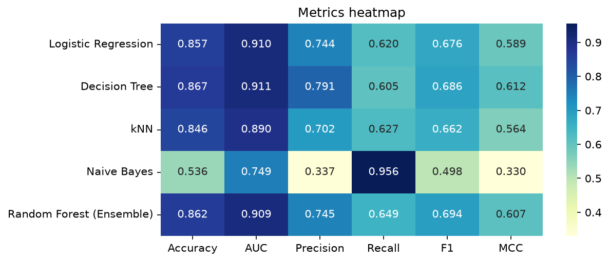


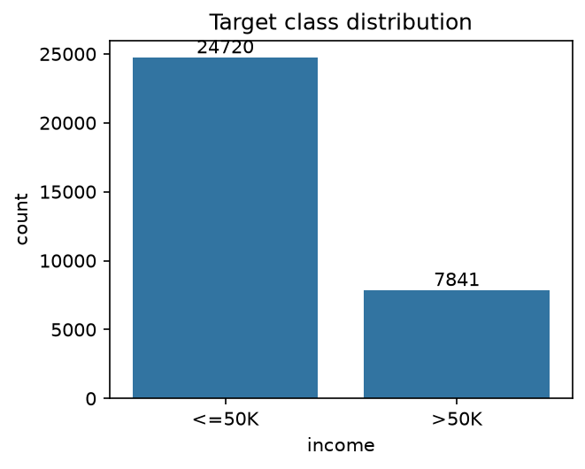

## 5. Observations
> 

| ML Model Name | Observation about model performance |
|---|---|
| Logistic Regression | accuracy 0.857, AUC 0.910, MCC 0.589; favours precision over recall (misses many >50K cases). Best on: none; weakest on: none. |
| Decision Tree | accuracy 0.867, AUC 0.911, MCC 0.612; favours precision over recall (misses many >50K cases). Best on: Accuracy, AUC, Precision, MCC; weakest on: Recall. |
| kNN | accuracy 0.846, AUC 0.890, MCC 0.564; favours precision over recall (misses many >50K cases). Best on: none; weakest on: none. |
| Naive Bayes | accuracy 0.536, AUC 0.749, MCC 0.330; favours recall over precision (over-predicts >50K). Best on: Recall; weakest on: Accuracy, AUC, Precision, F1, MCC. |
| Random Forest (Ensemble) | accuracy 0.862, AUC 0.909, MCC 0.607; favours precision over recall (misses many >50K cases). Best on: F1; weakest on: none. |
| **Overall winner** | *Overall winner (best average rank across 6 metrics): Decision Tree** (MCC 0.612, AUC 0.911).* |

## 6. Screenshots from BITS Virtual Lab
BITS Virtual Lab execution screenshot: 

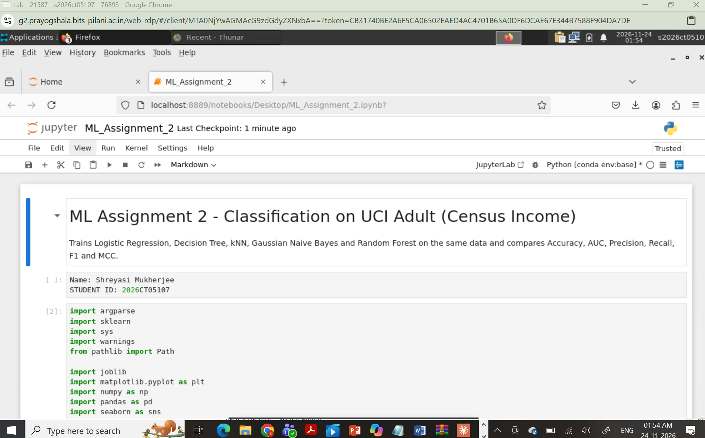
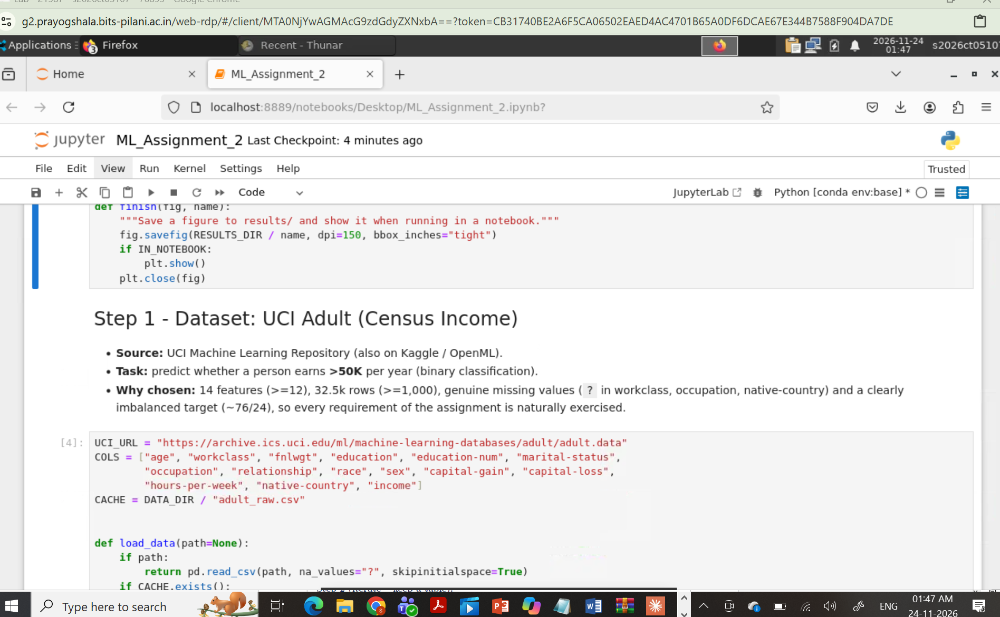
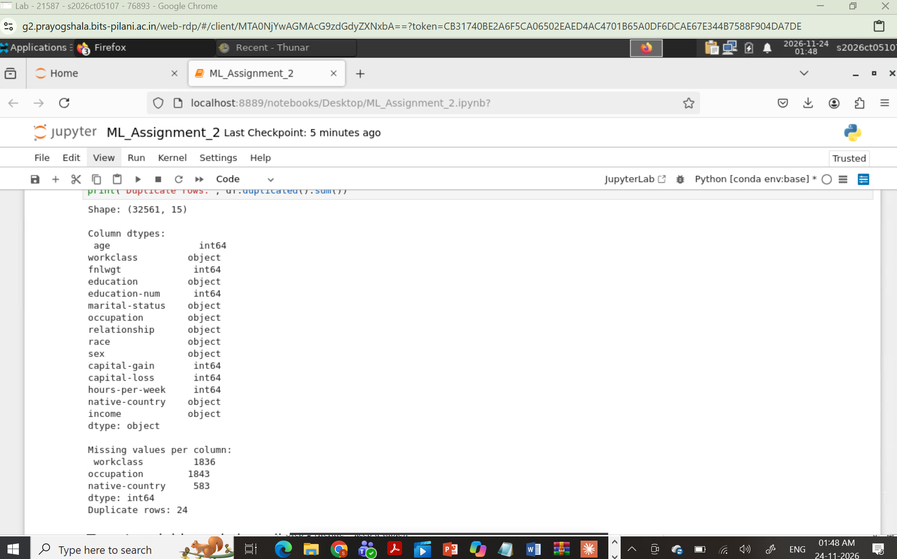
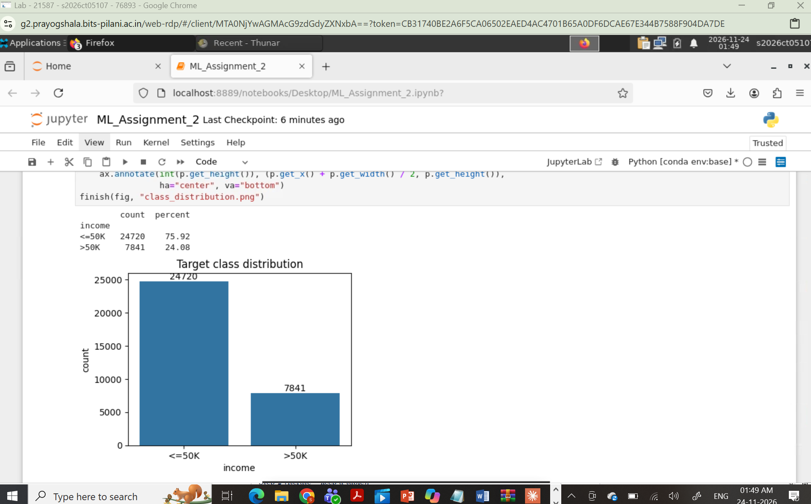
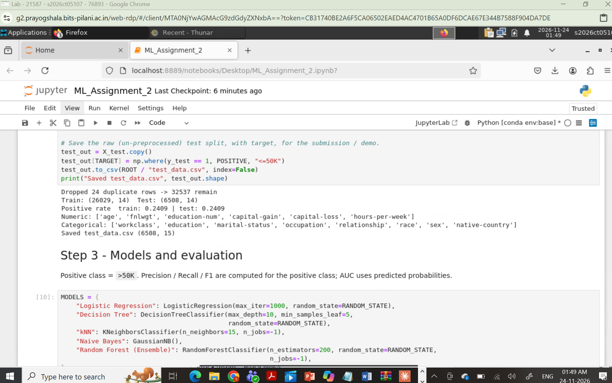
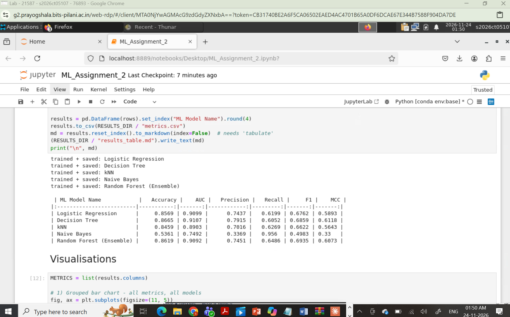
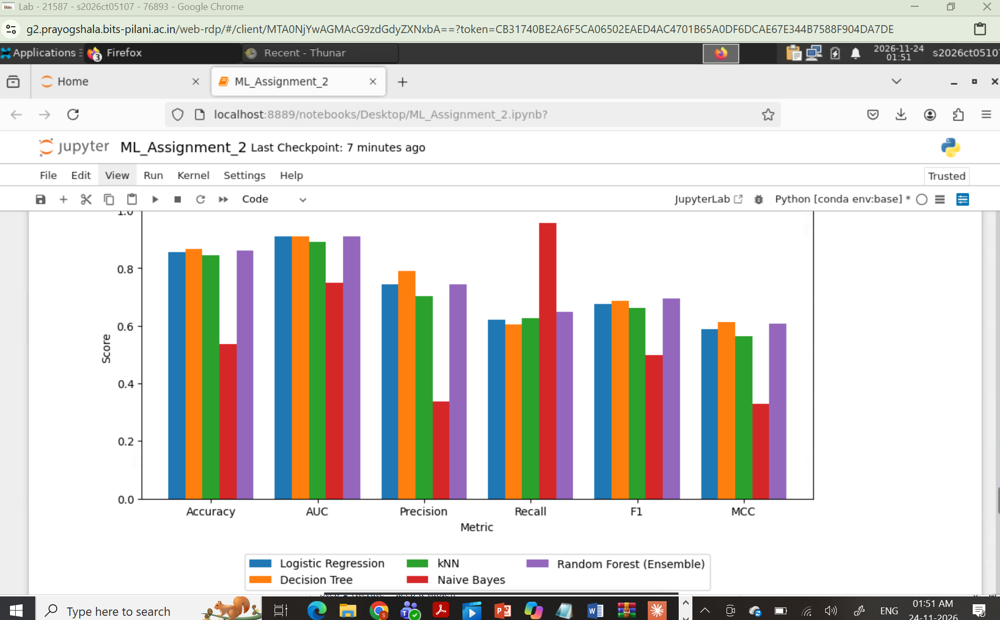
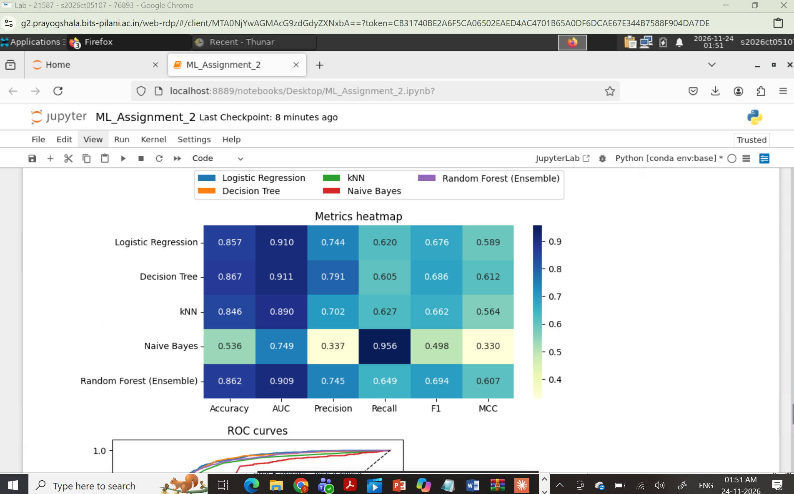
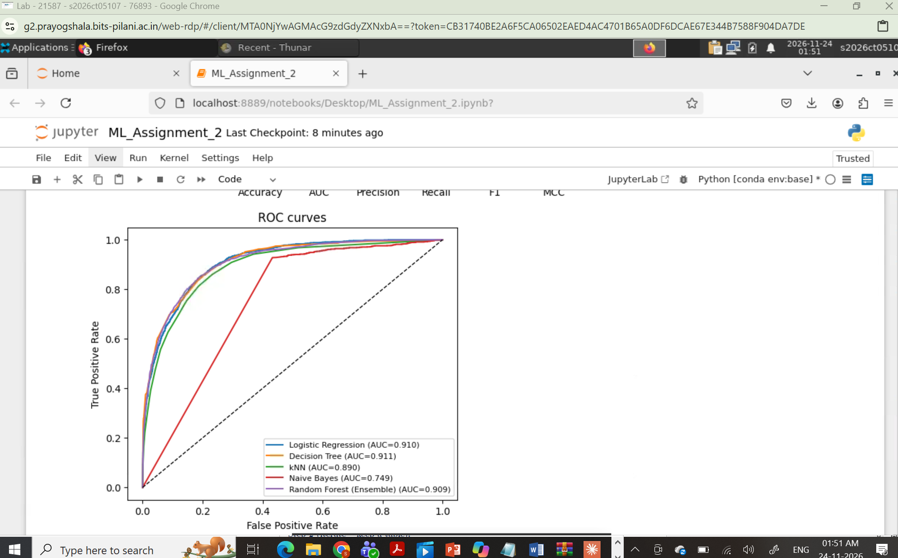
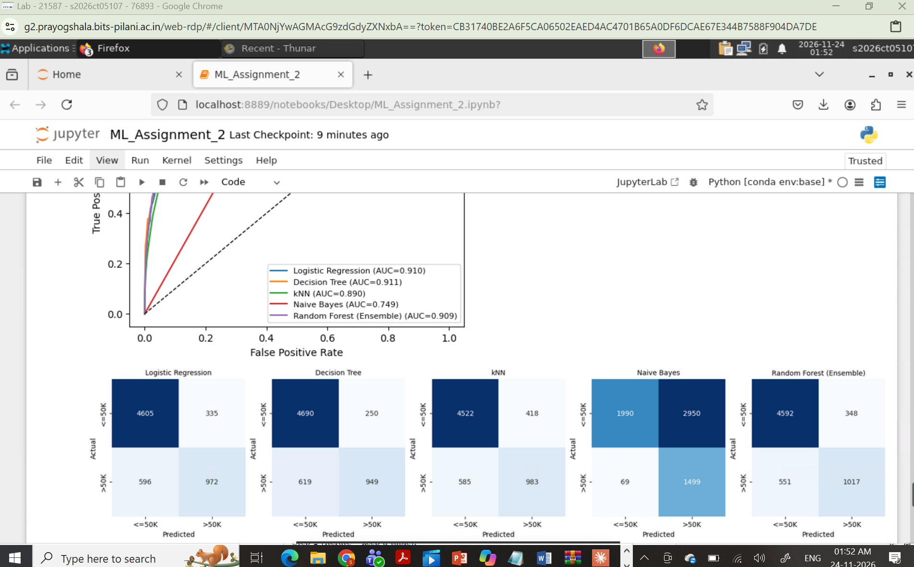

