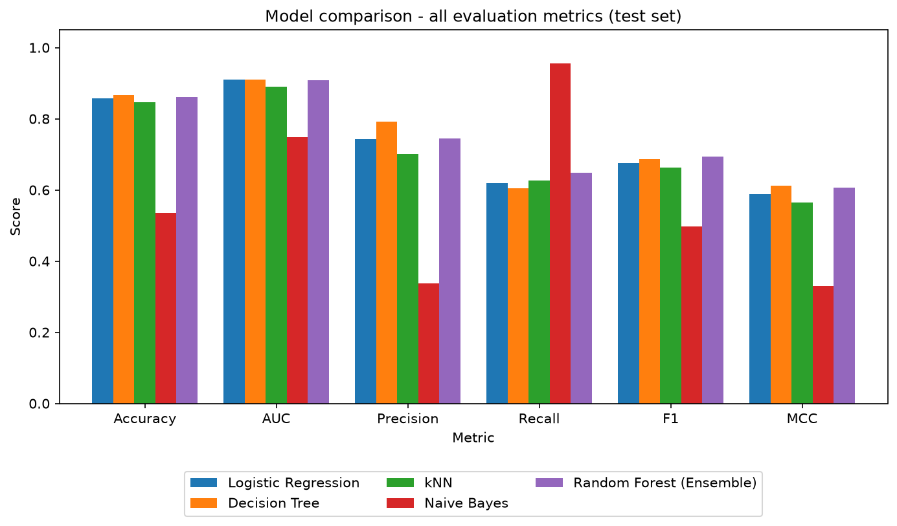
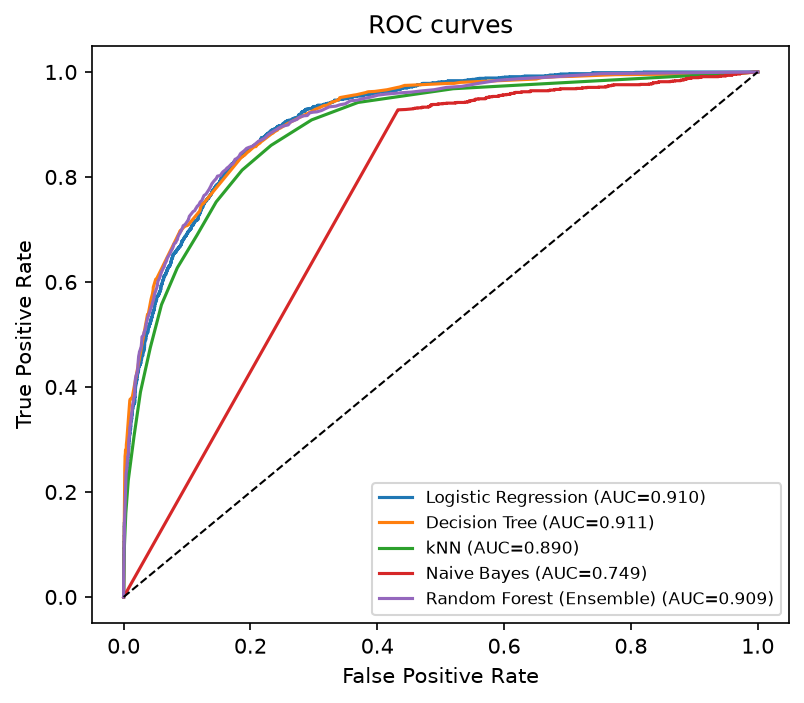
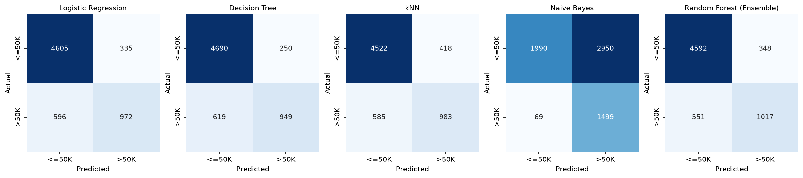

# ML Assignment 2 – Classification Models on UCI Adult (Census Income)

## 1. Problem Statement
Predict whether a person's annual income exceeds **$50K** from census attributes
(age, education, occupation, hours worked, etc.). This is a **binary classification** problem.
Five classifiers are trained on the same data and compared on Accuracy, AUC, Precision,
Recall, F1 and Matthews Correlation Coefficient (MCC).

## 2. Dataset Description
| Item | Detail |
|---|---|
| Source | UCI ML Repository – Adult (Census Income): https://archive.ics.uci.edu/dataset/2/adult |
| Instances | 32,561 raw rows (≈32,537 after removing duplicates) |
| Features | 14 (6 numeric, 8 categorical) – meets the ≥12 requirement |
| Target | `income` → `>50K` (positive, 1) vs `<=50K` (0) |
| Missing values | `?` in `workclass`, `occupation`, `native-country` (≈7% of rows affected) |
| Class balance | ≈76% `<=50K` / ≈24% `>50K` → **imbalanced**, so accuracy alone is misleading; AUC, F1 and MCC are emphasised |

**Why this dataset:** it satisfies every constraint (≥12 features, ≥1,000 rows, real missing values,
class imbalance, mixed numeric + categorical features), and is a well-known benchmark.

**Feature types**
* Numeric: `age, fnlwgt, education-num, capital-gain, capital-loss, hours-per-week`
* Categorical: `workclass, education, marital-status, occupation, relationship, race, sex, native-country`

### Preprocessing
| Step | Treatment |
|---|---|
| Duplicates | Dropped before splitting |
| Missing values | Numeric → median; categorical → most frequent (fitted on **train only**) |
| Encoding | One-Hot (`handle_unknown="ignore"`) |
| Scaling | `StandardScaler` on numeric features |
| Split | 80:20, `stratify=y` (class ratio preserved), `random_state=42` |
| Leakage control | All transformers live inside an sklearn `Pipeline` with the model, so they are fitted only on training data |

### Model configurations
| Model | Key settings |
|---|---|
| Logistic Regression | `max_iter=1000` |
| Decision Tree | `max_depth=10, min_samples_leaf=5` |
| kNN | `n_neighbors=15` |
| Naive Bayes | `GaussianNB` (defaults) |
| Random Forest | `n_estimators=200` |
All use `random_state=42`.

## 3. GitHub Repository Link
`<PASTE YOUR REPO URL HERE>`

```
project-folder/
│-- requirements.txt
│-- README.md
│-- test_data.csv                  # 20% hold-out test split (generated by the script)
│-- model/
│   │-- train_models.py            # end-to-end script
│   │-- ML_Assignment_2.ipynb      # same code as a notebook
│   └-- *.joblib                   # saved model pipelines (5 models)
│-- results/                       # metrics.csv, charts (generated)
```

### How to run
```bash
pip install -r requirements.txt
python model/train_models.py          # downloads the dataset from UCI automatically
# or open model/ML_Assignment_2.ipynb and Run All
```
Outputs are written to `results/`, `model/` and `test_data.csv`.

## 4. Models Used – Comparison Table
> Paste the contents of `results/results_table.md` here after running.

| ML Model Name | Accuracy | AUC | Precision | Recall | F1 | MCC |
|---|---|---|---|---|---|---|
| Logistic Regression |0.8569 | | | | | |
| Decision Tree | | | | | | |
| kNN | | | | | | |
| Naive Bayes | | | | | | |
| Random Forest (Ensemble) | | | | | | |

### Graphs






## 5. Observations
> Start from `results/auto_observations.md` and add the reasoning below, using YOUR numbers.

| ML Model Name | Observation about model performance |
|---|---|
| Logistic Regression | Strong linear baseline; with one-hot + scaled features it usually gives a high AUC and is stable. Check whether recall on the minority class (`>50K`) is lower than precision. |
| Decision Tree | Depth-limited to curb overfitting; easy to interpret, but typically lower AUC than ensembles because a single tree has high variance. |
| kNN | Sensitive to the ~100 one-hot dimensions (distance becomes less meaningful); typically high precision but weaker recall on the minority class; slowest at prediction time. |
| Naive Bayes | Gaussian assumption and feature independence fit one-hot data poorly; usually the lowest accuracy/MCC, often with very high recall but low precision (or the reverse) – look at the confusion matrix. |
| Random Forest (Ensemble) | Averaging many trees reduces variance and captures non-linear interactions; usually top or near-top on AUC/F1/MCC. |
| **Overall winner** | *Name the model with the best MCC/AUC/F1 in your table and justify it (MCC is the most reliable single number for an imbalanced target).* |

## 6. Screenshot
BITS Virtual Lab execution screenshot: `screenshots/bits_virtual_lab.png` (also included in the submitted PDF).
